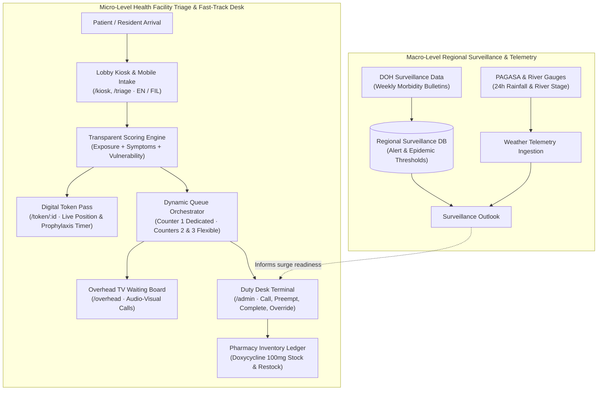

# 🛡️ LeptoShield

**Integrated Post-Flood Leptospirosis Triage, Dynamic Queue Orchestration, and Regional Epidemiological Surveillance**

[](https://fastapi.tiangolo.com)
[](https://react.dev)
[](https://vitejs.dev)
[](https://tailwindcss.com)
[](https://sqlmodel.tiangolo.com)
[](https://www.python.org)
[](LICENSE)

---

## 📋 Table of Contents

- [Overview](#-overview)
  - [The Public Health Challenge](#the-public-health-challenge)
  - [The LeptoShield Solution](#the-leptoshield-solution)
- [System Architecture](#-system-architecture)
- [Key Features & Surfaces](#-key-features--surfaces)
- [Explainable Clinical Decision Support Engine](#-explainable-clinical-decision-support-engine)
- [Repository Structure](#-repository-structure)
- [Quick Start](#-quick-start)
  - [Option A: One-Click Launch (Recommended)](#option-a-one-click-launch-recommended)
  - [Option B: Manual Development Setup](#option-b-manual-development-setup)
- [API & WebSocket Reference](#-api--websocket-reference)
- [Non-Diagnostic Boundary & Clinical Disclaimer](#-non-diagnostic-boundary--clinical-disclaimer)
- [Domain Terminology](#-domain-terminology)

---

## 🌊 Overview

### The Public Health Challenge

Leptospirosis (*Leptospira interrogans*) is an acute zoonotic bacterial infection transmitted through water or wet soil contaminated with rodent urine. In the Philippines, severe monsoon seasons and tropical typhoons submerge major urban centers and river basins (such as Metro Manila, Marikina, and Laguna). In the wake of major floods, primary health centers and emergency rooms face sudden, overwhelming patient surges.

Clinical efficacy hinges on immediate action:
- **Critical Prophylaxis Window:** Oral post-exposure prophylaxis (**doxycycline 100 mg**) is most protective when administered within the **48–72 hour therapeutic window** following floodwater contact.
- **Consequences of Delay:** Prolonged waiting times or delayed risk classification elevate patient progression into severe Weil's disease, pulmonary hemorrhage, acute renal failure, and mortality.

### The LeptoShield Solution

LeptoShield bridges the divide between high-level epidemiological monitoring and on-the-ground clinic workflow:

1. **Micro-Level Clinic Intake & Fast-Track Queueing:** 
   - Rapid 3-minute self-intake (English & Tagalog/Filipino) on mobile phones or clinic kiosks.
   - Explainable, deterministic risk scoring that categorizes patients into High, Moderate, and Low tiers.
   - Priority queue dispatch routing High-Risk patients directly to **Counter 1 (Fast-Track Lane)**, with automatic 30-second preemption protocols for flexible consultation counters.
   - Real-time digital patient passes, waiting room displays, and pharmacy doxycycline stock monitoring.
2. **Macro-Level Surveillance & Surge Preparedness:**
   - Regional monitoring using Department of Health (DOH) weekly morbidity surveillance thresholds.
   - Ingestion of PAGASA 24-hour rainfall warnings and river water-level telemetry.
   - Discrete-event queue simulation and surge stress-testing.

---

## 🏗️ System Architecture



### Technology Stack

- **Backend:** Python 3.10+, [FastAPI](https://fastapi.tiangolo.com/), [SQLModel](https://sqlmodel.tiangolo.com/) / [SQLAlchemy 2.0](https://www.sqlalchemy.org/), SQLite (WAL mode, foreign keys enabled).
- **Real-Time Communication:** Full-duplex WebSocket (`/ws`) broadcasting unified queue states and audit logs, paired with a resilient 15-second polling fallback.
- **Frontend:** [React 18](https://react.dev/), [Vite](https://vitejs.dev/), [Tailwind CSS](https://tailwindcss.com/), [Lucide React](https://lucide.dev/), QR code rendering (`qrcode.react`), tabular typography (`@fontsource/roboto-mono`).
- **Domain Package:** `packages/leptoshield_models` — canonical framework-independent SQLAlchemy models shared across modules.

---

## 🖥️ Key Features & Surfaces

| Surface | Route | Description |
| :--- | :--- | :--- |
| **Portal Hub** | `/` | System overview, live queue stats, active counters, weather telemetry, recent calls, and navigation to all clinic surfaces. |
| **Lobby Kiosk** | `/kiosk` | Touchscreen check-in display for clinic waiting areas featuring a live rotating QR code for touchless mobile intake. |
| **Patient Triage** | `/triage` | Fast 3-minute intake wizard with bilingual (English / Filipino) support assessing flood exposure depth, duration, wounds, and symptoms. |
| **Digital Patient Pass** | `/token/:id` | Mobile-friendly digital ticket showing token number (`H001`, `M004`, `L007`), live queue position, estimated wait, 72h prophylaxis window countdown, and counter call banner. |
| **Overhead Waiting Board** | `/overhead` | Large-format TV display for clinic waiting rooms with high-contrast active counter cards, call history, audio chime alerts, and flood advisories. |
| **Duty Desk Command Center** | `/admin` | Operational console for nurses and clinicians: queue dispatch, counter preemption, supervisory priority overrides, Doxycycline inventory tracking, and surge simulation. |

---

## 🧠 Explainable Clinical Decision Support Engine

The triage scoring algorithm ([`backend/triage_engine.py`](file:///d:/PJDSC/LeptoShield-main/LeptoShield-main/backend/triage_engine.py)) is completely transparent and audit-ready—every point contribution is explained back to the patient and clinician.

### 1. Risk Scoring Factors
- **Exposure Type:** Submerged / Swimming (`0.40`), Wading (`0.32`), Rodent / Mud contact (`0.38`), Soaked debris cleanup (`0.22`), None (`0.05`).
- **Duration Penalty:** Over 6 hours (`+0.20`), Over 2 hours (`+0.14`), 30 min to 2 hours (`+0.06`).
- **Skin Integrity:** Open cuts, abrasions, or mucosal exposure (`+0.25`).
- **Red-Flag Symptoms:** Yellow eyes/jaundice (`+0.20`, triggers urgent review), Oliguria/low urine (`+0.20`, triggers urgent review), Fever (`+0.18`), Muscle tenderness / calves (`+0.14`), Conjunctival suffusion / red eyes (`+0.16`), Headache (`+0.06`), Chills (`+0.05`).
- **Symptom Patterns:** Classic Triad (Fever + Calf Pain + Red Eyes) adds `+0.10`.
- **Vulnerabilities:** Geriatric ($\ge 60$ yrs, `+0.06`), Pediatric ($\le 12$ yrs, `+0.04`), Pregnancy (`+0.08`), Pre-existing chronic conditions (diabetes, kidney, liver, immune, heart: `0.05`–`0.08`).

```
Risk Score = Clamp( ∑ Points, 0.0, 1.0 )

Tiers:
  • High Risk (H)     : Score ≥ 0.60  OR  Presence of Severe Urgent Symptom (Jaundice / Anuria)
  • Moderate Risk (M) : Score ≥ 0.32
  • Low Risk (L)      : Score < 0.32
```

### 2. Dynamic Priority Queue Formula

To balance fast-tracking severe cases while preventing starvation in lower-tier queues, LeptoShield ranks waiting patients continuously:

$$\text{Priority} = \text{TierBase} + (100 \times \text{RiskScore}) + \text{WaitAgeing} + \text{Vulnerability}$$

- **Tier Base:** High = `1000.0`, Moderate = `500.0`, Low = `100.0`
- **Wait Ageing:** $2.4\text{ points/min}$ waited, capped at $240.0\text{ points}$ (100 minutes of wait credit)
- **Vulnerability Bonus:** Elderly / Pregnant / Pediatric ($+30.0$), Chronic Comorbidities ($+5.0$ to $+15.0$), Severe Symptoms ($+15.0$)

### 3. Automated Preemption Protocol

- **Counter 1:** Dedicated exclusively to High-Risk patients.
- **Counters 2 & 3:** Flexible consultation counters for all tiers.
- **30-Second Preemption:** When a High-Risk patient has waited $\ge 30\text{ seconds}$ without a dedicated counter available, the system prompts flexible counters with a preemption alert. Clinicians can conclude or safely return the non-critical patient to the head of the line with wait credits intact.

---

## 📁 Repository Structure

```
LeptoShield/
├── backend/                               # FastAPI backend application
│   ├── database.py                        # SQLite engine, connection sessions & PRAGMA setup
│   ├── main.py                            # REST endpoints, WebSocket handlers & SPA static mount
│   ├── models.py                          # SQLModel schemas (tickets, counters, inventory, audit)
│   ├── requirements.txt                   # Python dependencies (FastAPI, SQLModel, Uvicorn)
│   ├── seed_data.py                       # Seed script for DOH surveillance baselines & clinic queue
│   └── triage_engine.py                   # Transparent decision support & dynamic priority scoring
├── frontend/                              # React 18 + Vite SPA
│   ├── index.html                         # Entry HTML with accessibility & font definitions
│   ├── package.json                       # Frontend dependencies & scripts
│   ├── tailwind.config.js                 # Custom healthcare color design system
│   ├── vite.config.js                     # Vite build configuration & backend proxy
│   └── src/
│       ├── App.jsx                        # Application routes & error boundaries
│       ├── components/                    # UI views (Hub, Kiosk, Triage, Token, Overhead, Admin)
│       ├── hooks/useLiveQueue.js          # Synchronized WebSocket + REST polling React hook
│       ├── lib/format.js                  # Formatting helpers, time calculations & tier themes
│       └── services/api.js                # Axios API client & endpoints
├── packages/
│   └── leptoshield_models/                # Standalone canonical SQLAlchemy 2.0 models package
├── docs/                                  # Architectural Decision Records (ADRs) & documentation
├── GLOSSARY.md                            # Canonical domain terminology & language boundaries
├── report.md                              # Comprehensive technical architecture & evaluation report
├── run.bat                                # Windows turnkey launcher (checks deps, builds & serves)
└── run.command                            # macOS / Linux turnkey launcher
```

---

## 🚀 Quick Start

### Prerequisites

- **Python:** 3.10 or higher (3.11, 3.12, or 3.14 recommended)
- **Node.js:** 18.0 or higher with `npm`

---

### Option A: One-Click Launch (Recommended)

LeptoShield includes intelligent launchers for Windows and macOS/Linux that automatically verify runtimes, install dependencies, compile the frontend if needed, and start the unified server.

#### Windows
Simply double-click `run.bat` or run from PowerShell / Command Prompt:
```cmd
run.bat
```
*Helpful Windows flags:*
```cmd
run.bat dev         rem Start Vite hot-reload (5173) + FastAPI API (8000)
run.bat check       rem Run dependency check without installing anything
run.bat firewall    rem Allow ports 8000 and 5173 through Windows Firewall
```

#### macOS / Linux
Double-click `run.command` in Finder or execute from Terminal:
```bash
chmod +x run.command    # First time only
./run.command
```
*Helpful macOS flags:*
```bash
./run.command dev       # Hot-reload mode
./run.command check     # Dependency check
```

Once running:
- **Desktop Browser:** Automatically opens [http://localhost:8000](http://localhost:8000)
- **Mobile Devices (Same Wi-Fi):** The launcher prints the LAN IP (e.g., `http://192.168.1.50:8000`) for testing on tablets and smartphones.

---

### Option B: Manual Development Setup

If you prefer setting up the services independently:

#### 1. Backend Setup

```bash
cd backend

# Create and activate virtual environment
python -m venv .venv

# Windows
.venv\Scripts\activate
# macOS / Linux
source .venv/bin/activate

# Install requirements
pip install -r requirements.txt

# (Optional) Seed or reset the database with demo surveillance and queue data
python seed_data.py --reset

# Run FastAPI server
uvicorn main:app --host 0.0.0.0 --port 8000 --reload
```
The interactive API documentation is available at [http://localhost:8000/docs](http://localhost:8000/docs).

#### 2. Frontend Setup

In a new terminal window:
```bash
cd frontend

# Install Node dependencies
npm install

# Option A: Start Vite development server with hot-reload
npm run dev

# Option B: Build production bundle into dist/ (served directly by FastAPI)
npm run build
```
When running `npm run dev`, open [http://localhost:5173](http://localhost:5173). Vite automatically proxies API calls (`/api`) and WebSockets (`/ws`) to `http://localhost:8000`.

---

## 🔌 API & WebSocket Reference

### Key REST Endpoints

| Method | Endpoint | Description |
| :--- | :--- | :--- |
| `GET` | `/api/health` | Healthcheck and server timestamp. |
| `GET` | `/api/meta` | System metadata, triage engine contract, and scoring rules. |
| `POST` | `/api/triage` | Submit a patient intake assessment; returns scored token & factor XAI. |
| `GET` | `/api/triage/{identifier}` | Retrieve token details by UUID or token string (e.g., `H001`). |
| `GET` | `/api/queue` | Complete snapshot of waiting patients, serving counters, and metrics. |
| `POST` | `/api/queue/call` | Call the next prioritized patient to an intake counter (supports preemption). |
| `POST` | `/api/queue/complete` | Mark a consultation complete or no-show, record notes & dispensed meds. |
| `POST` | `/api/queue/override` | Supervisory manual tier escalation/de-escalation with audit reason. |
| `GET` | `/api/inventory` | Query Doxycycline 100mg stock on hand, par levels, and runout days. |
| `POST` | `/api/inventory/restock` | Record stock delivery with transaction logging. |
| `POST` | `/api/inventory/dispense` | Direct pharmacy stock dispensing ledger entry. |
| `GET` | `/api/surveillance` | Historical regional case counts, alert levels, and weather telemetry. |
| `POST` | `/api/demo/surge` | Synthetic scenario injection: add 4, 6, or 8 simulated patients to live queue. |
| `GET` | `/api/events` | Audit event query log. |

### Real-Time WebSocket (`/ws`)

Clients connect to `/ws` to receive immediate broadcasts on every state change:
- `queue_snapshot`: Full updated queue payload whenever patients check in, counters call, or visits complete.
- `called`: Counter call notification with token and counter assignment.
- `preempted`: Displaced patient notification with preserved wait credit.
- `override`: Priority adjustment alert.
- `restock` / `dispensed`: Pharmacy inventory updates.

---

## ⚠️ Non-Diagnostic Boundary & Clinical Disclaimer

> **IMPORTANT CLINICAL NOTICE**
> 
> LeptoShield is a **clinical decision support and administrative triage workflow tool**, **not a diagnostic system**. 
> - It does not provide medical diagnoses, establish laboratory confirmation, or substitute for professional medical judgment.
> - A low-risk triage score does **not** rule out leptospirosis.
> - If an individual experiences severe symptoms (such as yellow eyes/skin, dark tea-colored urine, absence of urine, severe shortness of breath, or bleeding), they must be evaluated by a qualified physician immediately regardless of calculated queue score.
> - Prophylaxis dispensing (such as Doxycycline) must always follow verified Department of Health (DOH) clinical practice guidelines and contraindication screening (e.g., in pregnancy or pediatric patients).

*For architectural guidelines on non-diagnostic boundaries, refer to [`docs/adr/0001-frontend-api-integration-and-non-diagnostic-boundary.md`](file:///d:/PJDSC/LeptoShield-main/LeptoShield-main/docs/adr/0001-frontend-api-integration-and-non-diagnostic-boundary.md).*

---

## 📖 Domain Terminology

To preserve semantic consistency across clinical and software boundaries, LeptoShield adheres strictly to the [`GLOSSARY.md`](file:///d:/PJDSC/LeptoShield-main/LeptoShield-main/GLOSSARY.md) domain definitions:

- **Intake Record:** An administrative facility record documenting patient presentation, structured flood exposure history, and workflow review status. *(Avoid: triage ticket, clinical chart)*
- **Queue Token:** A sequential alphanumeric identifier (e.g. `H001`, `M004`) assigned to a facility visitor for queue sequencing. *(Avoid: priority tier, severity badge)*
- **Surveillance Observation:** A reviewed regional weekly count of leptospirosis cases or deaths extracted from official public health surveillance reports with verified provenance.
- **Forecast Run:** An experimental point-in-time projection of regional weekly cases using count-bounded regression and rolling-origin backtesting. *(Avoid: outbreak warning, diagnostic prediction)*
- **Simulation Run:** A discrete-event scenario model estimating counter throughput and visitor wait times under hypothetical flood surge parameters.

---

## 📄 License

This project is licensed under the [MIT License](LICENSE).
