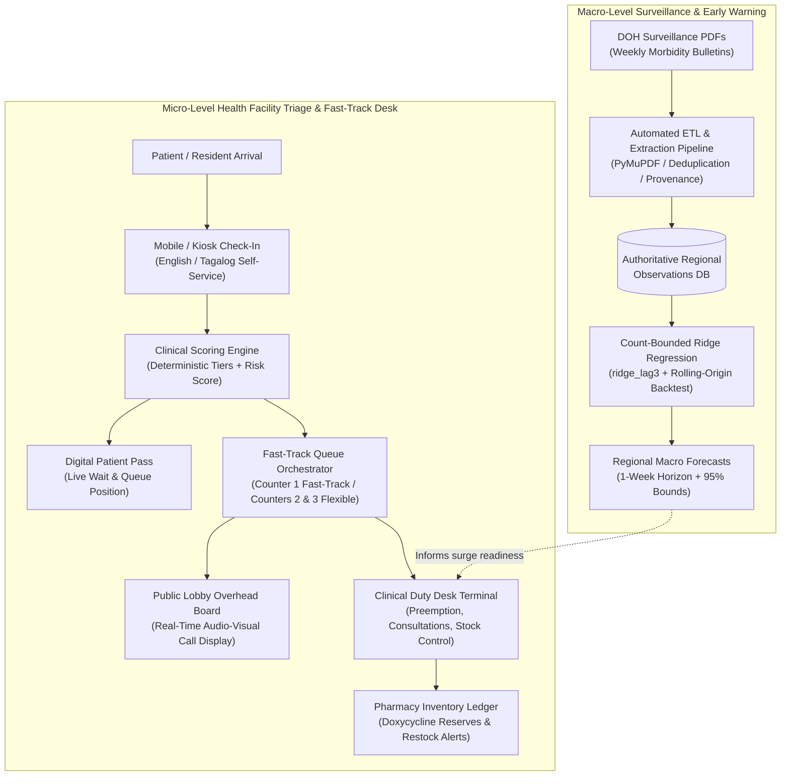

# LeptoShield: System Architecture, Core Features, Forecasting Model & Frontend Enhancement Roadmap

---

## 1. Executive Summary

**LeptoShield** is an integrated, dual-tier public health software platform engineered specifically for post-flood leptospirosis response in the Philippines. Leptospirosis (*Leptospira interrogans*) is an acute zoonotic bacterial infection transmitted through floodwaters contaminated with rodent urine. Following heavy monsoon seasons and typhoons across Metro Manila and surrounding river basins, health centers experience severe patient surges.

Clinical outcomes depend heavily on timely intervention: **oral post-exposure prophylaxis (doxycycline 100 mg)** is most effective when administered within the **48–72 hour therapeutic window** after floodwater contact. Delayed presentation or prolonged waiting times significantly increase the risk of Weil's syndrome, pulmonary hemorrhage, renal failure, and mortality.

LeptoShield solves this challenge by bridging two traditionally disconnected domains:
1. **Micro-Level Clinical Queue & Triage Management:** Deterministic, risk-stratified patient intake, automated fast-track lane dispatch, counter preemption for severe exposures, and pharmacy doxycycline inventory surveillance.
2. **Macro-Level Epidemiological Surveillance & Forecasting:** Ingestion of verified Department of Health (DOH) weekly morbidity bulletins, chronological rolling-origin backtesting, and an experimental Count-Bounded Ridge Regression (`ridge_lag3`) model with empirical uncertainty intervals and automatic baseline fallback.



---

## 2. System Architecture & Tech Stack

### 2.1 Backend Architecture
- **Runtime:** Python 3.14 / FastAPI
- **Data Persistence:** SQLAlchemy 2.0 / SQLModel with SQLite (configured with `PRAGMA foreign_keys=ON` and `PRAGMA journal_mode=WAL` for concurrent non-blocking reads).
- **Real-Time Communication:** Full-duplex WebSocket endpoints (`/ws`) broadcasting unified queue snapshots, state mutations, and audit events.
- **Authentication & RBAC:** OAuth2 Password Bearer flow using HMAC-SHA256 JWT tokens with role-based dependencies (`admin`, `health_official`, `clinic_staff`).
- **Data Integrity & Governance:** Strict natural key deduplication, optimistic concurrency version locking on intake records (`version` field), and an immutable append-only audit log (`audit_events`).

### 2.2 Frontend Architecture
- **Framework:** React 18 / Vite SPA
- **Styling:** Tailwind CSS with custom healthcare tokens (Paper, Surface, Ink, Teal, Moss, Ochre, Clay palettes).
- **Real-Time Synchronization:** `useLiveQueue` custom React hook blending instantaneous WebSocket push events with a background 15-second REST safety-net polling cycle.
- **Accessibility:** Skip-to-content anchors, semantic ARIA landmarks, numeric high-legibility tabular typography (`Roboto Mono`), and screen-reader safe error boundaries.

---

## 3. Core Feature Capabilities

### 3.1 Patient Kiosk & Fast-Track Triage Desk (`/kiosk`, `/triage`)
- **Self-Service & Assisted Mobile Check-In:** Designed for deployment on low-cost Android tablets in triage tents and community clinics.
- **Exposure Risk Assessment:** Evaluates floodwater wading level, contact duration (hours), exposure recency, and mucosal or open wound breaches.
- **Red-Flag Symptom Screening:** Rapid detection of clinical warning signs including oliguria/anuria, jaundice/scleral icterus, hemoptysis, calf muscle tenderness, persistent high fever, and meningismus.
- **Vulnerability Weighting:** Automatic priority adjustments for pediatric patients ($< 15$ yrs), geriatric patients ($\ge 60$ yrs), and pregnant women.
- **Deterministic 3-Tier Classification:**
  - **High Risk (Priority 1 · Fast-Track):** Immediate routing to Counter 1 for physician review and post-exposure prophylaxis initiation within the critical 48–72h window.
  - **Moderate Risk (Priority 2 · Clinician Review):** Routed to flexible assessment bays for symptom monitoring and wound care.
  - **Low Risk (Priority 3 · Standard Line):** Routine outpatient triage with educational guidance and self-monitoring advice.

```
Priority Score Formula:
  Priority = TierBase + (100 * RiskScore) + (AgeingFactor * WaitMinutes) + VulnerabilityBonus

  Where:
    - TierBase: High = 1000, Moderate = 500, Low = 100
    - RiskScore: Normalized clinical exposure score [0.0 - 1.0]
    - AgeingFactor: Dynamic acceleration preventing low-tier starvation
    - VulnerabilityBonus: Elderly (+50), Pregnant (+75), Pediatric (+30)
```

### 3.2 Dynamic Queue Orchestration & Counter Preemption
- **Dedicated vs. Flexible Counters:**
  - **Counter 1 (Fast-Track Lane):** Exclusively serves High-Risk patients. Stays in ready/standby mode when high-risk patients are present.
  - **Counters 2 & 3 (Flexible Consultation Bays):** Serve moderate and low-risk patients under normal operating load.
- **Automated Preemption Protocol:** If a high-risk patient enters the queue while Counters 2 and 3 are serving moderate/low-risk patients, the system activates a **30-second preemption threshold**. Clinicians receive an immediate visual alert to wrap up or temporarily return a non-critical patient to the head of the line, ensuring critical patients are seen without delay.

### 3.3 Digital Patient Pass (`/token/:id`) & Public Overhead Board (`/overhead`)
- **Digital Patient Token Pass:** Accessible via QR code or direct SMS link. Displays patient initials, token code (e.g., `H001`, `M004`), live queue position, estimated wait time, therapeutic window countdown, and active counter call banner.
- **Public Overhead Waiting Display:** High-contrast, large-format monitor view for clinic waiting rooms. Displays currently serving tokens per counter, recent call history, queue count summaries, and visual/audio chime indicators upon new calls.

### 3.4 Duty Desk & Pharmacy Inventory Terminal (`/admin`)
- **Clinician Dispatch Dashboard:** One-click controls to call the next prioritized patient, preempt flexible counters, close visits, or record no-shows.
- **Supervisory Override Modal:** Allows attending medical officers to escalate or de-escalate patient priority with mandatory written justification and immutable audit logging.
- **Doxycycline 100 mg Inventory Tracker:**
  - Live stock-on-hand tracking with par levels and critical reorder thresholds.
  - Projected consumption cover in days based on rolling 24-hour clinic throughput.
  - Delivery restock modal with transaction ledger audit trails.
- **Surge & Weather Telemetry:** Live ingestion of PAGASA 24-hour rainfall warnings and Pasig River gauge telemetry to calculate localized flood-surge alert levels.

### 3.5 Discrete-Event Queue Capacity Simulation (`/admin`)
- **Dual-Mode Simulator:**
  - **Live Desk Surge Injection:** Injects 4, 6, or 8 synthetic patients with randomized clinical profiles into the live queue to test staff response and preemption behavior.
  - **24-Hour Discrete-Event Capacity Model:** A discrete-event Poisson arrival simulation ($M/M/c$ queue) allowing health administrators to test policies (`aging_weighted`, `priority_tier`, `fifo`), arrival rates, counter staffing numbers, and service duration to measure P90 wait times and counter utilization.

---

## 4. Epidemiological Surveillance & Regional Forecasting Model

### 4.1 Automated Surveillance Ingestion Pipeline
The pipeline (`data-pipeline-weekly-surveilance`) processes official DOH Epidemiology Bureau Weekly Surveillance Bulletins:
1. **PDF Text & Table Extraction:** Uses PyMuPDF (`fitz`) to parse structured regional tables from PDF publications.
2. **Reconciliation & Normalization:** Resolves regional naming variants (`NCR`, `Region IV-A / CALABARZON`, `BARMM`), maps epidemiological Morbidity Weeks (MW), and standardizes metric values.
3. **Weekly Incidence Derivation:** Converts cumulative year-to-date counts into discrete weekly incident series:
   $$\text{WeeklyCases}_t = \max(0, \text{CumulativeCases}_t - \text{CumulativeCases}_{t-1})$$
4. **Natural Key Deduplication & Provenance:** Enforces deterministic record keys and stores SHA-256 source report hashes for cryptographic auditability.

### 4.2 Count-Bounded Ridge Regression (`ridge_lag3`)
To forecast macro-level regional leptospirosis case counts 1 week ahead ($t+1$), LeptoShield uses **Count-Bounded Ridge Regression** on 3-week autoregressive lag features.

#### Mathematical Formulation:
Given historical weekly counts $y_1, y_2, \dots, y_T$, the feature vector for predicting week $t+1$ is:
$$\mathbf{x}_t = [y_{t-1}, y_{t-2}, y_{t-3}]^T \in \mathbb{R}^3$$

The model solves the $L_2$-regularized ordinary least squares problem with unregularized bias $b$:
$$\min_{\mathbf{w}, b} \sum_{i} \left( y_i - (\mathbf{w}^T \mathbf{x}_i + b) \right)^2 + \alpha \|\mathbf{w}\|_2^2$$
*(Default regularization penalty $\alpha = 1.0$ applied exclusively to lag weights, not intercept).*

To satisfy physical epidemiology constraints (case counts cannot be negative), the raw prediction is projected using **non-negative count bounding**:
$$\hat{y}_{t+1} = \max\left(0.0, \, \mathbf{w}^T \mathbf{x}_t + b\right)$$

### 4.3 Chronological Rolling-Origin Backtesting
Cross-validation with randomized k-fold splits causes severe future-data leakage in epidemiological time series. LeptoShield enforces **chronological rolling-origin evaluation**:
- For evaluation step $k \in [4, T-1]$, training is restricted to observations prior to $k$ ($[0 \dots k-1]$).
- A 1-step-ahead prediction is generated for week $k$, yielding true out-of-sample residuals:
  $$e_k = y_k - \hat{y}_k$$
- Computes out-of-sample **Mean Absolute Error (MAE)** and **Root Mean Squared Error (RMSE)**.

### 4.4 Automated Baseline Fallback Mechanism (Specification Rule BR-008)
Every candidate Ridge model is benchmarked against two standard persistence baselines:
1. **Naive Lag-1 Persistence Baseline:** $\hat{y}_{t+1} = y_t$
2. **Trailing 3-Week Moving Average:** $\hat{y}_{t+1} = \frac{1}{3}\sum_{j=0}^{2} y_{t-j}$

**Automatic Fallback Rule:**
$$\text{If } \text{MAE}_{\text{Ridge}} \ge \text{MAE}_{\text{Naive}}, \quad \text{SelectedPrediction} = y_t, \quad \text{fallback\_applied} = \text{true}$$
If the Ridge regression fails to strictly outperform naive persistence, the system automatically falls back to naive lag-1 persistence while retaining both candidate and baseline error metrics in the audit ledger.

### 4.5 95% Empirical Uncertainty Bounds
Rather than assuming Gaussian asymptotic normality on short time series, LeptoShield derives uncertainty intervals directly from the empirical out-of-sample residual variance:
$$s_e = \sqrt{\frac{1}{N-1} \sum_{k=1}^N (e_k - \bar{e})^2}$$
$$\text{Lower Bound} = \max(0.0, \, \hat{y} - 1.96 \cdot s_e), \quad \text{Upper Bound} = \hat{y} + 1.96 \cdot s_e$$

**Eligibility Gate for Bounds:**
- Requires at least $N \ge 4$ evaluated backtest steps.
- If $N < 4$, uncertainty bounds are set to `null` to prevent fabricating uncalibrated statistical certainty.

### 4.6 Strict Data Continuity Gate (Specification Rule BR-003)
- The model enforces a minimum technical prerequisite of **4 consecutive weekly reviewed periods** without chronology gaps.
- If a timeline gap is detected (e.g., missing DOH reports such as MW5, or multi-week reporting pauses), the engine **strictly refuses to interpolate zeros or invent synthetic numbers**.
- Returns HTTP 200 with `status: "unavailable"` and an explicit diagnostic reason (e.g., *"Surveillance gap detected for region NCR between 2025-01-25 and 2025-03-01"*).

---

## 5. Security Architecture & RBAC Matrix

| Endpoint Group | Description | Allowed Roles |
| :--- | :--- | :--- |
| `POST /api/v1/auth/login` | User authentication & JWT issuance | Public |
| `GET /api/v1/auth/me` | Current session user verification | All authenticated users |
| `POST /api/v1/clinic/intakes` | Register clinic intake record | `admin`, `health_official`, `clinic_staff` |
| `GET /api/v1/clinic/intakes` | Query and filter intake records | `admin`, `health_official`, `clinic_staff` |
| `PATCH /api/v1/clinic/intakes/:id/status`| Update triage status with version check | `admin`, `health_official`, `clinic_staff` |
| `GET /api/v1/surveillance/regions` | List distinct surveillance regions | `admin`, `health_official`, `clinic_staff` |
| `GET /api/v1/surveillance/observations` | Query approved historical observations | `admin`, `health_official`, `clinic_staff` |
| `GET /api/v1/surveillance/export.csv` | Export regional observations | `admin`, `health_official`, `clinic_staff` |
| `POST /api/v1/surveillance/source-reports`| Create / ingest source surveillance report | `admin`, `health_official` |
| `POST /api/v1/surveillance/source-reports/:id/review`| Approve or reject source report | `admin`, `health_official` |
| `POST /api/v1/forecasts/runs` | Execute regional Ridge forecast run | `admin`, `health_official`, `clinic_staff` |
| `GET /api/v1/forecasts/runs` | Retrieve historical forecast audit runs | `admin`, `health_official`, `clinic_staff` |
| `POST /api/v1/simulations/runs` | Execute 24h queue simulation model | All authenticated users |
| `GET /api/v1/audit/events` | Inspect immutable audit trails | `admin`, `health_official` |

---

## 6. Comprehensive Frontend Improvement Roadmap

While the LeptoShield frontend is functional, resilient, and responsive, the following high-priority enhancements are recommended for production deployment in Philippine disaster response centers.

### 6.1 Geospatial Map & Spatial Risk Visualizations
- **Interactive Philippine Regional Choropleth Map:**
  - Replace or augment the plain text region selector in `/forecasts` with an interactive SVG / Leaflet choropleth map.
  - Color-code regions dynamically based on epidemic threshold status (Green = Normal, Amber = Alert, Crimson = Epidemic Breach).
  - Clicking on a region directly loads its historical time series, alert margins, and forecast models.
- **Barangay-Level Flood Exposure Heatmap:**
  - On `/admin`, render a localized heatmap of incoming triage patients mapped by barangay (e.g., Tumana, Malanday, Sto. Niño in Marikina; Tondo, Sampaloc in Manila).
  - Highlights real-time disease clusters before regional weekly reports are published.

### 6.2 Offline-First Progressive Web App (PWA) & Field Resilience
- **Offline Triage Queueing via Service Workers & IndexedDB:**
  - In actual disaster zones, power outages and cellular cell tower congestion frequently cut internet connectivity.
  - Configure a Service Worker and local `IndexedDB` caching to allow nurses to register intake tokens completely offline.
  - Automatically sync queued intake records via background sync once connectivity is restored.
- **Thermal Receipt Printer & Barcode Support:**
  - Integrate a Web Bluetooth / WebUSB thermal printer driver into `/kiosk` and `/triage` to print physical paper slips with QR codes and tokens for elderly patients without smartphones.

### 6.3 Accessibility & Multi-Lingual Inclusivity
- **Full Filipino / Tagalog Language Toggle:**
  - While `/triage` includes Tagalog symptom descriptions, navigation bars, modal dialogs, and `/overhead` displays are currently in English.
  - Implement a persistent language toggle (`EN` | `FIL`) using `react-i18next`.
- **Audio Chime & Speech Synthesis Queue Announcements:**
  - Add native Web Audio API chimes and Filipino/English text-to-speech voice announcements to `/overhead`:
    > *"Token H-0-0-1, pumunta sa Counter 1."* / *"Token H-0-0-1, please proceed to Counter 1."*
- **Outdoor High-Contrast Triage Mode:**
  - Add a dedicated ultra-high-contrast sunlight-readable theme (pure black on stark white with yellow accents) for outdoor evacuation tents.

### 6.4 Forecasting Analytics & Interactive Scenario Planning
- **Visual Confidence Band Overlays:**
  - Upgrade the visual bar chart in `/forecasts` to an interactive line/area chart (using Chart.js, Recharts, or Vega-Lite).
  - Display the historical observation series, the 1-week-ahead point forecast dot, and a shaded vertical ribbon representing the 95% empirical uncertainty interval $[ \hat{y} - 1.96 \cdot s_e, \, \hat{y} + 1.96 \cdot s_e ]$.
- **What-If Rainfall Sensitivity Slider:**
  - Add an interactive scenario slider adjusting hypothetical monsoon rainfall (+50mm, +100mm, +200mm) to show clinicians projected surge volume and doxycycline demand.

### 6.5 Architectural & Component Refactoring
- **State Management & Query Caching:**
  - Transition from manual `useEffect` + `useState` fetch routines to **TanStack Query (React Query)** or **Zustand**.
  - Eliminates duplicate network requests, provides out-of-the-box caching, and simplifies background polling.
- **Modular Component Decomposition:**
  - `AdminDashboardView.jsx` is currently over 1,300 lines of code. Decompose it into sub-modules:
    - `components/admin/CounterGrid.jsx`
    - `components/admin/LiveQueueTable.jsx`
    - `components/admin/PharmacyCard.jsx`
    - `components/admin/SurveillanceOutlook.jsx`
    - `components/admin/SimulationModal.jsx`
- **End-to-End Automated Testing:**
  - Integrate Playwright or Cypress tests verifying the full critical patient flow:
    *Patient Kiosk Check-In $\rightarrow$ Token Generation $\rightarrow$ Counter 1 Call $\rightarrow$ Consultation Complete $\rightarrow$ Pharmacy Stock Decrement*.

---

## 7. Verification & Automated Test Status

| Component | Test Suite | Results | Status |
| :--- | :--- | :---: | :---: |
| **Backend API** | `pytest tests/` | **35 passed, 0 failed** (100%) | ✅ Operational |
| **Data Pipeline** | `uv run --with pytest pytest` | **64 passed, 0 failed** (100%) | ✅ Operational |
| **Frontend Production Build** | `npm run build` (`vite build`) | **Compiled clean in 3.93s** | ✅ Deployed |
| **RBAC Security Matrix** | `verify_auth_trace.py` | **8/8 User Roles Verified** | ✅ Enforced |
| **Forecasting Engine** | `test_forecast_service.py` | **10/10 Verification Tests Passed** | ✅ Enforced |

---
*Report generated for LeptoShield Project Workspace · October 2026.*

